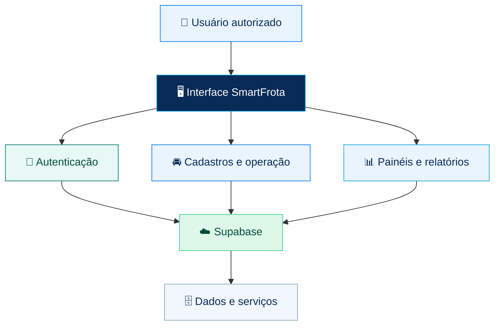

<!-- SmartFrota | README visual -->
<div align="center">

# 🚛 <span style="color:#087FE8">Smart</span><span style="color:#16A6E8">Frota</span>

### <span style="color:#082B57">GESTÃO PÚBLICA DE FROTAS</span>

**Controle, manutenção e transparência para uma frota pública mais eficiente.**

<p>
  
  
  
  
</p>

[🌐 **Abrir sistema**](https://devkove.github.io/SmartFrota/) · [📦 **Repositório**](https://github.com/DevKove/SmartFrota) · [🐛 **Relatar problema**](https://github.com/DevKove/SmartFrota/issues)

---

</div>

## ✨ Visão geral

O **SmartFrota** é uma aplicação voltada à gestão pública de veículos e dos processos ligados à operação da frota. A interface reúne ferramentas para acompanhar veículos, secretarias, condutores, manutenção, abastecimento, suprimentos, contratos e relatórios.

> <span style="color:#087FE8"><strong>Objetivo:</strong></span> organizar informações operacionais, facilitar o acompanhamento dos custos e apoiar decisões administrativas com mais rastreabilidade.

## 🧭 Módulos do sistema

<table>
  <tr>
    <td width="50%">
      <h3>🚘 Frota e pessoas</h3>
      <ul>
        <li>Veículos e frota</li>
        <li>Secretarias e responsáveis</li>
        <li>Condutores</li>
        <li>Usuários e perfis de acesso</li>
      </ul>
    </td>
    <td width="50%">
      <h3>🛠️ Operação e manutenção</h3>
      <ul>
        <li>Ordens de serviço</li>
        <li>Planos de manutenção</li>
        <li>Abastecimentos</li>
        <li>Inspeções, checklists e ocorrências</li>
      </ul>
    </td>
  </tr>
  <tr>
    <td>
      <h3>📦 Suprimentos e contratos</h3>
      <ul>
        <li>Fornecedores e prestadores</li>
        <li>Almoxarifado e peças</li>
        <li>Contratos</li>
        <li>Orçamento por secretaria</li>
      </ul>
    </td>
    <td>
      <h3>📊 Gestão e acompanhamento</h3>
      <ul>
        <li>Painel de visão geral</li>
        <li>Relatórios</li>
        <li>Gestão de usuários e permissões</li>
        <li>Interface adaptável para celular</li>
      </ul>
    </td>
  </tr>
</table>

## 🖼️ Identidade visual

A interface usa uma identidade inspirada em tecnologia e gestão pública: azul institucional, tons claros, cartões organizados e destaques em ciano.

<div align="center">

| <span style="color:#061F3E">Azul-marinho</span> | <span style="color:#087FE8">Azul principal</span> | <span style="color:#16A6E8">Ciano</span> | <span style="color:#F1F6FC">Fundo claro</span> |
|:---:|:---:|:---:|:---:|
|  |  |  |  |

</div>

## 🧩 Como a aplicação funciona



### Tecnologias

<p>
  
  
  
  
  
  
</p>

- **Interface:** HTML, CSS e JavaScript.
- **Serviços e autenticação:** Supabase, incluindo função de API do projeto.
- **Publicação da interface:** GitHub Pages.
- **PWA:** manifesto, ícones e service worker incluídos no projeto. A instalação e o funcionamento offline devem ser confirmados nos navegadores/dispositivos de destino.

## 🚀 Acessar e executar

### Acesso pela web

Use a versão publicada:

**➡️ https://devkove.github.io/SmartFrota/**

O acesso às funções protegidas depende de uma conta autorizada e da configuração válida dos serviços Supabase.

### Executar localmente

Como a interface é baseada em arquivos web, você pode clonar o repositório e servir os arquivos localmente:

```bash
git clone https://github.com/DevKove/SmartFrota.git
cd SmartFrota
```

Abra a pasta em um servidor HTTP local. Por exemplo, com Python instalado:

```bash
python -m http.server 8000
```

Depois acesse [http://localhost:8000](http://localhost:8000).

> **Importante:** abrir a interface localmente não configura automaticamente o backend. As URLs e chaves públicas necessárias ao cliente devem corresponder ao projeto Supabase correto. Nunca coloque chaves secretas ou service-role no código do navegador nem as publique no README.

## 🔐 Segurança e acesso

- Entre com as credenciais fornecidas pelo administrador.
- O acesso a recursos protegidos deve ser validado pelo backend.
- Não compartilhe senhas, tokens de sessão ou chaves secretas em issues, commits ou capturas de tela.
- Em caso de falha de acesso, verifique o console do navegador e os registros da função Supabase antes de alterar dados ou redefinir credenciais.

## 📱 Uso em dispositivos móveis

A interface possui regras responsivas para telas menores. Para testar, abra o endereço publicado em um celular ou use o modo de dispositivo móvel nas ferramentas de desenvolvedor do navegador.

A presença dos arquivos PWA não garante, por si só, que todos os navegadores ofereçam instalação ou que todos os recursos funcionem sem conexão.

## 🛣️ Próximos passos sugeridos

- [ ] Validar login e recuperação de sessão em navegadores suportados.
- [ ] Testar os fluxos de cada perfil de usuário.
- [ ] Validar a experiência em telas pequenas.
- [ ] Testar instalação PWA e cenários offline.
- [ ] Revisar permissões e políticas de acesso do Supabase.

## 🤝 Contribuição

1. Abra uma [issue](https://github.com/DevKove/SmartFrota/issues) descrevendo o problema ou a melhoria.
2. Explique os passos para reproduzir o comportamento observado.
3. Para alterações maiores, proponha uma branch e um pull request.
4. Nunca inclua credenciais, dados pessoais reais ou informações sigilosas nos exemplos.

## 📄 Licença

Consulte o arquivo [LICENSE](./LICENSE) para conhecer os termos de uso e distribuição do projeto.

---

<div align="center">

**<span style="color:#087FE8">SmartFrota</span>** · Tecnologia para uma gestão pública mais eficiente. 🚛

<sub>Documentação em português do Brasil · Projeto DevKove</sub>

</div>
