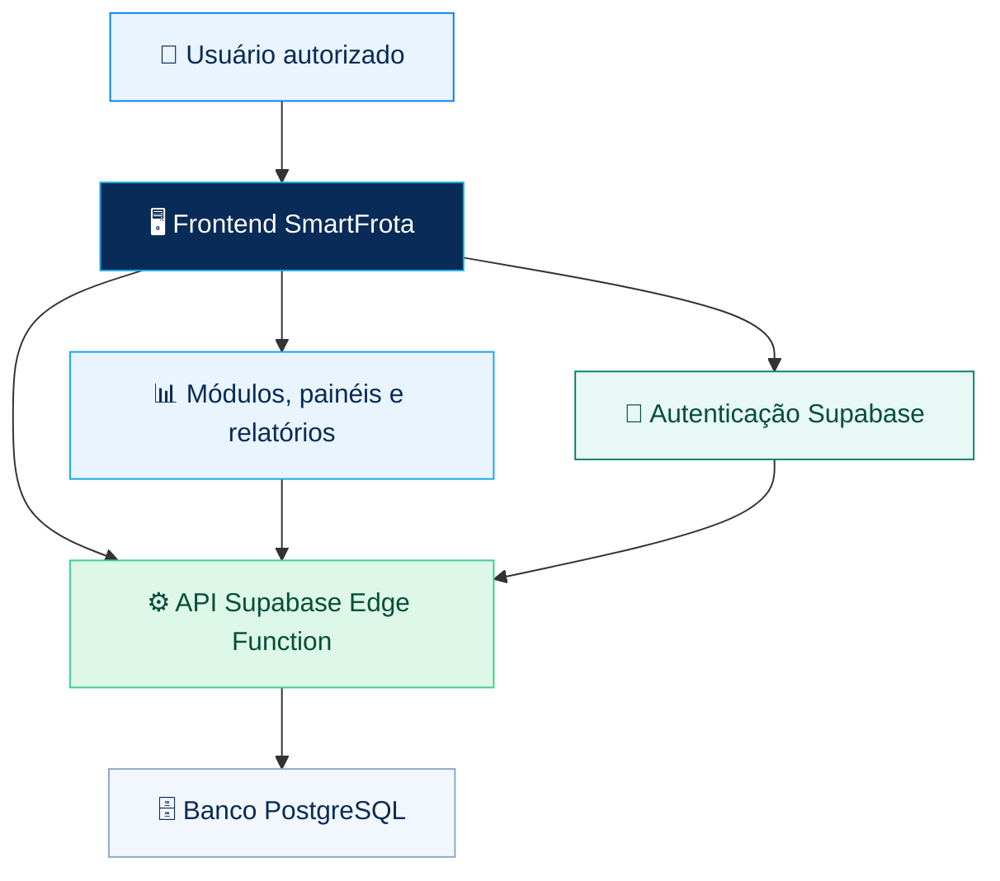

<!-- SmartFrota | README visual e status de validação -->
<div align="center">

# 🚛 <span style="color:#087FE8">Smart</span><span style="color:#16A6E8">Frota</span>

### <span style="color:#082B57">GESTÃO PÚBLICA DE FROTAS</span>

**Controle, manutenção e transparência para uma frota pública mais eficiente.**

<p>
  
  
  
  
</p>

[🌐 **Abrir sistema**](https://devkove.github.io/SmartFrota/) · [📦 **Repositório**](https://github.com/DevKove/SmartFrota) · [🧪 **Validações CI**](https://github.com/DevKove/SmartFrota/actions) · [🐛 **Relatar problema**](https://github.com/DevKove/SmartFrota/issues)

---

</div>

## ✨ Visão geral

O **SmartFrota** é uma aplicação de gestão pública de veículos e dos processos ligados à operação da frota. A interface reúne ferramentas para acompanhar veículos, secretarias, condutores, manutenção, abastecimento, suprimentos, contratos e relatórios.

> <span style="color:#087FE8"><strong>Objetivo:</strong></span> organizar informações operacionais, apoiar o controle de custos e facilitar decisões administrativas com rastreabilidade e permissões por perfil.

## 🟢 Estado atual e validação

| Verificação | Situação | O que significa |
|---|---|---|
| Validação automatizada do código | **Aprovada** | As verificações estáticas do projeto passaram no GitHub Actions. |
| Smoke test da API | **Aprovado** | A API respondeu ao teste de acesso sem token com o erro esperado `401 missing_bearer_token`. |
| Publicação do frontend | **Concluída** | O workflow do GitHub Pages terminou com sucesso. |
| Função de API Supabase | **Versão 18 implantada** | A função `frotagov-api` está implantada no Supabase; o nome interno foi mantido para compatibilidade. |
| Login real e fluxos autenticados | **Pendente** | Ainda precisam ser testados com uma conta de teste autorizada. |
| CRUD completo, isolamento por secretaria e uso offline | **Pendente** | Não são considerados aprovados até que sejam executados testes específicos. |

**Última rodada de validação registrada:** [GitHub Actions — execução 34](https://github.com/DevKove/SmartFrota/actions/runs/40021517526).  
**Publicação do frontend:** [GitHub Pages — execução 109](https://github.com/DevKove/SmartFrota/actions/runs/40021316230).

> ⚠️ **Importante:** os testes automatizados aprovados não equivalem a uma homologação completa. O login com credenciais válidas, operações autenticadas, permissões entre secretarias, relatórios e restauração de backup ainda exigem testes ponta a ponta.

## 🧭 Módulos do sistema

<table>
  <tr>
    <td width="50%">
      <h3>🚘 Frota e pessoas</h3>
      <ul>
        <li>Veículos e frota</li>
        <li>Secretarias e responsáveis</li>
        <li>Condutores</li>
        <li>Usuários e perfis de acesso</li>
      </ul>
    </td>
    <td width="50%">
      <h3>🛠️ Operação e manutenção</h3>
      <ul>
        <li>Ordens de serviço</li>
        <li>Planos de manutenção</li>
        <li>Abastecimentos</li>
        <li>Inspeções, checklists e ocorrências</li>
      </ul>
    </td>
  </tr>
  <tr>
    <td>
      <h3>📦 Suprimentos e contratos</h3>
      <ul>
        <li>Fornecedores e prestadores</li>
        <li>Almoxarifado, peças e movimentações</li>
        <li>Contratos e documentos</li>
        <li>Orçamento por secretaria</li>
      </ul>
    </td>
    <td>
      <h3>📊 Gestão e acompanhamento</h3>
      <ul>
        <li>Painel e relatórios</li>
        <li>Gestão de usuários e permissões</li>
        <li>Dados financeiros e operacionais</li>
        <li>Interface adaptável para celular</li>
      </ul>
    </td>
  </tr>
</table>

## 🖼️ Identidade visual

A identidade do SmartFrota combina azul institucional, ciano e tons claros para facilitar a leitura de informações operacionais.

<div align="center">

| <span style="color:#061F3E">Azul-marinho</span> | <span style="color:#087FE8">Azul principal</span> | <span style="color:#16A6E8">Ciano</span> | <span style="color:#0B806B">Verde</span> |
|:---:|:---:|:---:|:---:|
|  |  |  |  |

</div>

## 🧩 Arquitetura da aplicação

O frontend é publicado pelo GitHub Pages. Autenticação, API e dados utilizam os serviços do Supabase configurados para o projeto.



### 🧰 Tecnologias

<p>
  
  
  
  
  
</p>

- **Interface:** HTML, CSS e JavaScript.
- **Autenticação, API e dados:** Supabase Auth, Edge Functions e PostgreSQL.
- **Publicação do frontend:** GitHub Pages.
- **PWA:** existem arquivos de suporte no projeto; instalação e funcionamento offline precisam ser validados nos navegadores e dispositivos de destino.

## 🚀 Acessar e executar

### Acesso pela web

**➡️ https://devkove.github.io/SmartFrota/**

O acesso às funções protegidas depende de uma conta autorizada e dos serviços Supabase configurados corretamente.

### Executar localmente

Requisitos: Git e Python 3 (para servir os arquivos localmente).

```bash
git clone https://github.com/DevKove/SmartFrota.git
cd SmartFrota
python -m http.server 8000
```

Abra [http://localhost:8000](http://localhost:8000).

> **Atenção:** servir os arquivos localmente não configura automaticamente o backend. O cliente precisa apontar para o projeto Supabase correto. Nunca inclua chaves secretas, credenciais administrativas ou chaves `service_role` no navegador, no repositório ou neste README.

## 🔐 Segurança e acesso

- As rotas protegidas da API exigem um token Bearer válido.
- O endpoint de logout solicita ao Supabase a revogação da sessão local/refresh token; um JWT de acesso já emitido pode permanecer válido até expirar.
- A API não deve confiar apenas em elementos ocultos na interface para autorizar operações.
- As permissões e o isolamento dos dados por secretaria devem ser verificados em testes autenticados.
- Não compartilhe senhas, tokens de sessão, chaves secretas nem dados pessoais reais em issues, commits ou capturas de tela.

## 🧪 Testes e auditoria

Os testes automatizados disponíveis estão no repositório:

- [Validação de JavaScript e regressões](./scripts/validate-inline-js.mjs)
- [Smoke test da API](./scripts/smoke-api.mjs)
- [Workflow de validação contínua](./.github/workflows/validate-smartfrota.yml)
- [Relatório de auditoria técnica](./auditoria.md)
- [Código da função Supabase](./supabase/functions/frotagov-api/index.ts)

O smoke test verifica a resposta da API quando a requisição não possui token de autenticação. **Ele não comprova sozinho** que login, logout autenticado, criação/edição de registros ou isolamento entre secretarias funcionam ponta a ponta.

## 📱 Dispositivos móveis e uso offline

A interface inclui regras responsivas para telas menores. Para verificar o comportamento, abra o endereço publicado em um celular ou use o modo de dispositivo móvel nas ferramentas do navegador.

A existência de arquivos PWA não garante que todos os navegadores ofereçam instalação nem que todas as funções estejam disponíveis sem conexão. O funcionamento offline, a sincronização e a recuperação após falhas precisam ser testados antes de serem considerados validados.

## 🛣️ Próximas etapas de validação

- [x] Validar regressões estáticas automatizadas.
- [x] Confirmar que a API rejeita requisições sem token.
- [x] Confirmar publicação do frontend pelo GitHub Pages.
- [ ] Testar login e recuperação de sessão com uma conta de teste autorizada.
- [ ] Testar logout com token válido.
- [ ] Executar operações de criação, leitura, edição e exclusão nos módulos aplicáveis.
- [ ] Verificar isolamento entre secretarias e perfis de acesso.
- [ ] Testar relatórios, telas pequenas, instalação PWA e cenários offline.
- [ ] Validar backup e restauração em ambiente controlado.

## 🤝 Contribuição

1. Abra uma [issue](https://github.com/DevKove/SmartFrota/issues) descrevendo o problema ou a melhoria.
2. Informe os passos para reproduzir o comportamento observado, sem incluir credenciais ou dados sensíveis.
3. Para alterações maiores, proponha uma branch e um pull request.
4. Execute as validações automatizadas antes de enviar alterações.

## 📄 Licença

Consulte o arquivo [LICENSE](./LICENSE) para conhecer os termos de uso e distribuição do projeto.

---

<div align="center">

**<span style="color:#087FE8">SmartFrota</span>** · Tecnologia para uma gestão pública mais eficiente. 🚛

<sub>Documentação em português do Brasil · Projeto DevKove</sub>

</div>
